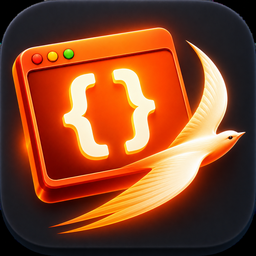

<p align="center">
  
</p>

<h1 align="center">Build Swift Apps</h1>

<p align="center">
  <strong>Build, debug, and ship Swift apps with your coding agent.</strong>
</p>

<p align="center">
  <a href="https://github.com/Xopoko/build-swift-apps/actions/workflows/ci.yml"></a>
</p>

Build Swift Apps is a pack of agent skills for iOS and macOS. It gives Codex,
Claude Code, Cursor, and pi workflows for projects that use SwiftUI, AppKit,
Xcode, Swift Package Manager, or Tuist.

## What it does

- Build and run on Simulator, inspect the UI and logs, or run SwiftUI package
  previews with hot reload.
- Refactor SwiftUI and AppKit code, stabilize UI tests, and investigate CPU,
  memory, or rendering problems.
- Measure clean and incremental builds before changing Xcode settings or the
  SwiftPM dependency graph.
- Check signing and notarization, validate App Store exports, and work with
  TestFlight and App Store Connect.

## Install

Apple toolchain workflows need a Mac with Xcode. From Windows or Linux, run
those steps on a Mac over SSH or through a configured remote XcodeBuildMCP
connection. Source review and portable helpers can run wherever their own
dependencies are available. [Host setup](docs/INSTALL.md#execution-host)

Paste this into your coding agent for guided setup.

```text
Install Build Swift Apps from https://github.com/Xopoko/build-swift-apps.
Follow the installation guide for this agent, run the doctor checks, and
report the installed plugin and any missing dependencies.
```

### Codex

On a Mac with `git` and `python3`, run these commands from a terminal.

```bash
mkdir -p "$HOME/.agents/plugins/plugins"
git clone https://github.com/Xopoko/build-swift-apps.git \
  "$HOME/.agents/plugins/plugins/build-swift-apps"
cd "$HOME/.agents/plugins/plugins/build-swift-apps"

./scripts/install-local-plugin.sh
./scripts/doctor.sh --profile core --profile mcp
```

Start a new Codex chat after installation.

### Claude Code

```text
/plugin marketplace add Xopoko/build-swift-apps
/plugin install build-swift-apps@build-swift-apps
/reload-plugins
```

For Cursor, pi, manual installs, and optional tools, see the
[installation guide](docs/INSTALL.md).

## Use it

Open your Swift project in the agent and ask for an outcome. The
`build-swift-apps` router points the agent to the relevant skill. You can also
name the skill in your prompt. In Claude Code, call a skill with
`/build-swift-apps:<skill-name>`.

> Use `ios-simulator-debugger` to build and run this app. Show the first
> screen with `ios-simulator-browser` and summarize any launch errors.

> Use `xcode-build-strategist` to measure clean and incremental builds.
> Recommend changes based on the timing data.

The [preview launcher](skills/ios-simulator-browser/SKILL.md#swiftui-preview-workflow)
runs previews from SwiftUI packages in iOS Simulator.

## Included skills

<details>
<summary>Browse every skill</summary>

### Build, run, debug, and test

| Skill | Purpose |
| --- | --- |
| `build-swift-apps` | Route broad or ambiguous Swift and Apple-platform work to the right focused skill. |
| `macos-runtime-debugger` | Build, launch, log, and debug local macOS apps and desktop executables. |
| `macos-swiftpm-runner` | Build, run, and test SwiftPM-first macOS packages and command-line tools. |
| `macos-test-diagnoser` | Triage failing Xcode or SwiftPM test runs and separate real regressions from setup issues. |
| `xcode-ui-test-stabilizer` | Create, stabilize, and run Xcode UI tests with focused failure evidence. |
| `macos-telemetry-probe` | Add lightweight `Logger` instrumentation and verify events through runtime logs. |

### iOS Simulator, profiling, and runtime evidence

| Skill | Purpose |
| --- | --- |
| `ios-simulator-browser` | Preferred user-facing Simulator surface: mirror an iOS app into the Codex browser and render SwiftUI package previews with hot reload. |
| `ios-simulator-debugger` | Use XcodeBuildMCP to build, run, inspect, and debug iOS simulator apps; hand off to `ios-simulator-browser` for visible proof. |
| `ios-rocketsim-operator` | Use RocketSim's bundled agent skill and CLI for visible simulator UI interaction. |
| `ios-ettrace-profiler` | Capture and interpret symbolicated ETTrace profiles for iOS simulator flows. |
| `ios-memgraph-inspector` | Capture, inspect, and compare simulator memory graphs with `leaks` evidence. |
| `swiftui-performance-inspector` | Audit SwiftUI performance from code structure before asking for profiling evidence. |

### SwiftUI, AppKit, and product UI

| Skill | Purpose |
| --- | --- |
| `ios-swiftui-architect` | Build iOS SwiftUI screens with navigation, layout, state, forms, sheets, and media patterns. |
| `macos-swiftui-architect` | Build macOS SwiftUI scenes, commands, toolbars, settings, split views, and menu bar extras. |
| `swiftui-view-architect` | Refactor SwiftUI views into stable, testable, dependency-explicit components. |
| `macos-view-architect` | Refactor macOS SwiftUI scenes and sidebar/detail structures. |
| `macos-appkit-bridge` | Bridge SwiftUI to AppKit only where native macOS behavior needs it. |
| `macos-window-architect` | Tune macOS 15+ SwiftUI windows, placement, restoration, and scene behavior. |
| `ios-intents-architect` | Design App Intents, entities, queries, and shortcuts for Siri, Spotlight, widgets, and controls. |
| `macos-liquid-glass-designer` | Adopt modern macOS SwiftUI design and Liquid Glass conventions. |
| `ios-liquid-glass-designer` | Implement and review iOS 26+ Liquid Glass SwiftUI features. |

### Xcode build performance

| Skill | Purpose |
| --- | --- |
| `xcode-build-strategist` | End-to-end recommend-first build optimization: benchmark, analyze, prioritize, approve, fix, verify. |
| `xcode-build-baseline` | Produce repeatable clean and incremental Xcode build baselines with artifacts. |
| `xcode-compile-profiler` | Find Swift compile and type-checking hotspots with compiler diagnostics. |
| `xcode-project-auditor` | Audit build settings, schemes, target dependencies, and script phases. |
| `swiftpm-build-inspector` | Analyze Swift Package Manager graph shape, plugins, pins, and module variants. |
| `xcode-build-tuner` | Apply approved build optimizations and re-benchmark to prove impact. |

### Release, signing, and distribution

| Skill | Purpose |
| --- | --- |
| `macos-signing-inspector` | Diagnose existing macOS app signing, entitlements, sandboxing, hardened runtime, Gatekeeper, and trust-policy issues. |
| `macos-notarization-packager` | Prepare or diagnose Developer ID distribution artifacts, bundle structure, and notarization readiness. |
| `appstore-release-director` | Orchestrate an end-to-end iOS App Store release from local repo state through App Store Connect review readiness. |
| `app-icon-studio` | Create, evaluate, export, and install iOS AppIcon asset catalogs or macOS .icns bundle icons. |
| `appstore-screenshot-studio` | Generate, revise, translate, scrape, and crop App Store marketing screenshot panels. |

### App Store Connect (`asc` CLI)

These skills use the public `asc` command from
[`rorkai/App-Store-Connect-CLI`](https://github.com/rorkai/App-Store-Connect-CLI).
They cover auth and command discovery, ID resolution, Xcode archive/export,
TestFlight, submission readiness, metadata and localization, screenshots,
signing, notarization, subscriptions/IAP pricing, crash triage, Apple Ads, and
workflow automation.

Skills: `appstore-connect-cli`, `appstore-id-resolver`, `appstore-archive-uploader`,
`appstore-build-monitor`, `appstore-testflight-coordinator`, `appstore-release-planner`,
`appstore-review-readiness`, `appstore-metadata-sync`, `appstore-metadata-localizer`,
`appstore-release-notes-writer`, `appstore-aso-auditor`, `appstore-screenshot-validator`,
`appstore-screenshot-pipeline`, `appstore-signing-setup`, `appstore-notary-runner`,
`appstore-record-creator`, `appstore-ads-operator`, `appstore-pricing-planner`,
`appstore-subscription-localizer`, `appstore-revenuecat-sync`,
`appstore-crash-insights`, `appstore-workflow-runner`, `appstore-wall-publisher`.

### Tuist and generated projects

| Skill | Purpose |
| --- | --- |
| `tuist-migration-planner` | Move an existing Xcode project toward a Tuist-generated workspace. |
| `tuist-workspace-navigator` | Work effectively in Tuist-generated Xcode workspaces. |
| `tuist-generation-doctor` | Reproduce and triage generation or post-generation build failures. |
| `tuist-flaky-test-stabilizer` | Use Tuist test insights to investigate and fix flaky test cases. |

### Research and low-level Apple work

| Skill | Purpose |
| --- | --- |
| `apple-dev-research` | Search Apple Dev Search for Swift, SwiftUI, Xcode, iOS, and macOS community writing. |
| `apple-firmware-inspector` | Use the `ipsw` CLI for Apple firmware, dyld shared cache, Mach-O, entitlements, and private API research. |

</details>

## Develop from source

The plugin runs directly from its source files. On macOS or Linux, clone the
repository and run these checks in Bash with Python 3 installed.

```bash
git clone https://github.com/Xopoko/build-swift-apps.git
cd build-swift-apps
./scripts/validate-package.sh
python3 -B -m unittest discover -s scripts/tests
bash scripts/tests/test-doctor.sh
bash scripts/tests/test-install-deps.sh
bash scripts/tests/test-install-local-plugin.sh
```

On Windows, use WSL for the Bash checks. Run the portable tests from a native
terminal with `python -B -m unittest discover -s scripts/tests`.

On a Mac with Xcode and Node.js, check the development environment as well.

```bash
./scripts/doctor.sh --profile core --profile mcp --strict
```

| Path | Contents |
| --- | --- |
| [`skills/`](skills/) | Each workflow's `SKILL.md`, with any scripts or references specific to it. |
| [`shared/`](shared/) and [`commands/`](commands/) | Reusable helpers and short agent entry points. |
| [`.codex-plugin/`](.codex-plugin/), [`.claude-plugin/`](.claude-plugin/), [`.cursor-plugin/`](.cursor-plugin/), and [`package.json`](package.json) | Agent packaging for Codex, Claude Code, Cursor, and pi. |
| [`scripts/`](scripts/) and [`docs/`](docs/) | Installers, checks, tests, and setup guides. |

[Contribution guide](CONTRIBUTING.md) and [changelog](CHANGELOG.md).

## Privacy

Build, test, and Simulator tools run on the configured host. Installing or
updating tools may download dependencies. Apple documentation lookups through
the bundled `apple-docs` MCP server send queries to its hosted endpoint. App
Store workflows can send archives and metadata to Apple through the configured
`asc` CLI. Your agent's settings govern how it handles project context.

Report vulnerabilities through the [private reporting instructions](SECURITY.md).

## License

[MIT license](LICENSE) and [third-party notices](NOTICE).
